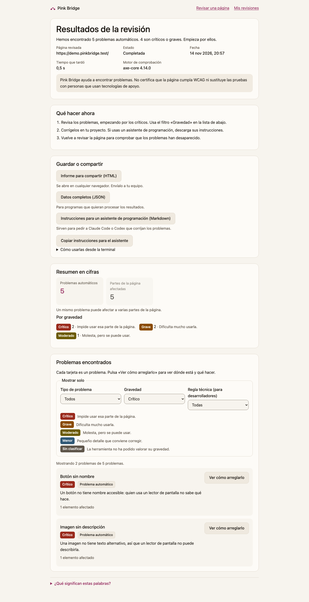
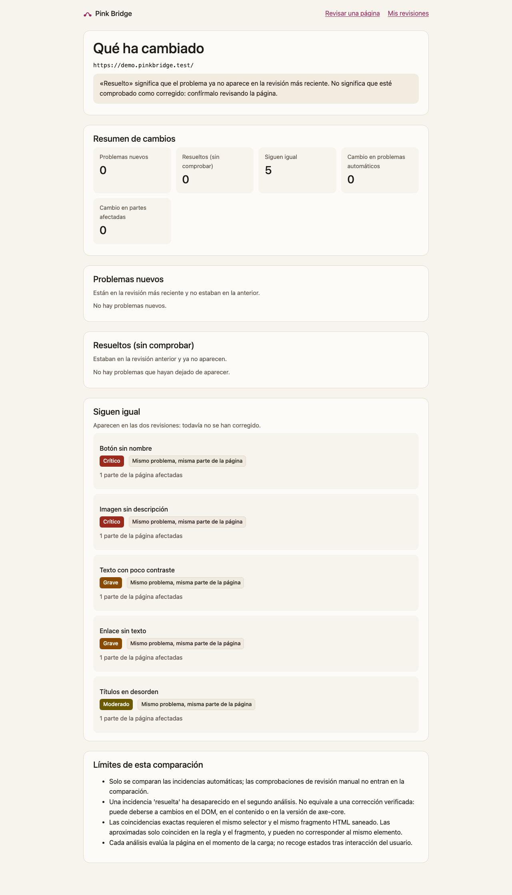

# Pink Bridge

[](https://github.com/marcoojea/pink-bridge/actions/workflows/ci.yml) [](https://github.com/marcoojea/pink-bridge/actions/workflows/a11y-demo.yml)   [](LICENSE)

## In English

Pink Bridge checks web pages for accessibility problems and tells you what changed since the last check. It opens the page in an isolated Chromium with Playwright, runs axe-core, and compares each run with the previous one: new, resolved and persistent issues.

- **Who it is for:** development and QA teams with a live site that cannot fix every problem at once.
- **Try it:** the [read-only demo with sample data](https://marcoojea.github.io/pink-bridge/) needs no install. Example report: [HTML](https://marcoojea.github.io/pink-bridge/demo/analyses/f69e5f9d-4257-4c9e-baff-6eea43aad813/report.html) and [JSON](https://marcoojea.github.io/pink-bridge/demo/analyses/f69e5f9d-4257-4c9e-baff-6eea43aad813/report.json). Locally, `docker compose up --build` serves it at http://127.0.0.1:8080.
- **CI:** the CLI `npm run cli -- audit` compares a page with a baseline file kept in git, and exits with code 1 only when new serious or critical issues appear. See [Usarlo en tu CI](#usarlo-en-tu-ci) below.
- **Stack:** TypeScript (strict), React 19 and Vite, Fastify 5, SQLite (better-sqlite3), Zod as the shared contract, Playwright, axe-core, Vitest, ESLint, Docker and GitHub Actions.
- **Security:** URL validation, a destination guard on every connection, an isolated browser with per-session proxy credentials, and size and time limits. There is no user authentication, so it is meant for local or internal use.
- **Limits:** axe-core does not catch every problem, a resolved issue is not verified as fixed, and only public pages without login are supported.






---

## Versión en español

Plataforma de auditoría de accesibilidad web y generación de informes QA. Analiza una URL en un navegador aislado con axe-core, separa las incidencias automáticas de las comprobaciones que requieren revisión manual, guarda cada ejecución y permite revisar, exportar y comparar.

> **Alcance actual:** una URL o un sitio acotado por `maxPages` en el mismo dominio. Sin autenticación ni cuotas: es una herramienta de uso local o interno. Ver [Limitaciones](#limitaciones-y-riesgos-residuales).

## Funcionalidades

- Validación de la URL (http/https, sin credenciales, puertos permitidos, sin tokens en la query).
- Análisis con Chromium y axe-core con progreso por etapas reales.
- Resultados con resumen, filtros combinables (tipo, gravedad, regla) y detalle con selectores y fragmentos HTML saneados.
- Estados de revisión humana (pendiente, revisada, aceptada, corregida) guardados aparte de los resultados.
- Informes descargables en JSON y HTML, generados desde el mismo modelo.
- Histórico persistente en SQLite. Repetir un análisis crea otro nuevo y no sobrescribe el anterior.
- Comparación de dos análisis completados de la misma URL: nuevas, resueltas y persistentes.
- Recorrido de sitio: hasta 10 páginas del mismo dominio, cada una en móvil (390), tablet (768) y escritorio (1280). Cada incidencia indica página y tamaño.
- Pruebas QA además de axe: errores de consola y de página, recursos con error HTTP, contenido mixto, enlaces rotos entre las páginas visitadas, y formularios probados con envío vacío y con datos de prueba (los envíos no-GET se interceptan y nunca salen a la red).
- Prompt exportable (Markdown) para Claude Code o Codex, con los fragmentos HTML delimitados como datos.
- Demostración con un fixture de defectos documentados (ver [catálogo](docs/fixture-catalog.md)); demo de sitio multipágina con `target: "demo-site"`.

## Stack

| Capa                | Tecnología                                                                         |
| ------------------- | ---------------------------------------------------------------------------------- |
| Lenguaje            | TypeScript estricto (`tsconfig.base.json`)                                         |
| Interfaz            | React 19 + Vite 8, enrutado por hash                                               |
| API                 | Node.js 24 + Fastify 5                                                             |
| Motor               | Playwright (Chromium) + axe-core 4.14                                              |
| Contrato compartido | Zod 4 (`packages/shared`)                                                          |
| Persistencia        | SQLite con better-sqlite3 y migraciones numeradas                                  |
| Tests               | Vitest, React Testing Library, Playwright Test, `@axe-core/playwright`             |
| Calidad             | ESLint 9 (typescript-eslint, react-hooks, jsx-a11y), Prettier, Husky + lint-staged |
| CI                  | GitHub Actions; Dependabot semanal                                                 |

Node se fija en `.nvmrc` (24) y en `engines`; `engine-strict` impide instalar con otra versión.

## Instalación

```bash
npm ci
npx playwright install chromium
```

## Ejecución local

En dos terminales:

```bash
PINK_BRIDGE_ENABLE_DEMO=1 npm run dev:api   # API en http://127.0.0.1:3001
npm run dev:web                             # Interfaz en http://127.0.0.1:5173 (proxy /api → 3001)
```

`PINK_BRIDGE_ENABLE_DEMO=1` habilita la demostración. Sin esa variable, `target: "demo"` responde 404.

## Variables de entorno

| Variable                        | Por defecto               | Uso                                                                                                       |
| ------------------------------- | ------------------------- | --------------------------------------------------------------------------------------------------------- |
| `PORT`                          | `3001`                    | Puerto de la API                                                                                          |
| `HOST`                          | `127.0.0.1`               | Interfaz de escucha de la API                                                                             |
| `PINK_BRIDGE_DB`                | `data/pink-bridge.sqlite` | Fichero de la base de datos (carpeta `data/` ignorada por git)                                            |
| `PINK_BRIDGE_ENABLE_DEMO`       | desactivada               | Habilita el fixture de demostración                                                                       |
| `PINK_BRIDGE_ALLOW_REMOTE`      | desactivada               | Permite `HOST` distinto de loopback. Sin control de acceso delante, no usar                               |
| `PINK_BRIDGE_TOKEN`             | desactivada               | Si se define (16 caracteres o más), toda la API salvo `/api/health` exige `Authorization: Bearer <token>` |
| `PINK_BRIDGE_CREATE_PER_MINUTE` | `10`                      | Creaciones de análisis permitidas por IP y minuto; después responde `429 rate_limited`                    |

## Comandos

| Comando                      | Qué hace                                                                                  |
| ---------------------------- | ----------------------------------------------------------------------------------------- |
| `npm run lint`               | ESLint sobre todo el repositorio                                                          |
| `npm run format:check`       | Prettier en modo comprobación                                                             |
| `npm run typecheck`          | `tsc` en shared, API, interfaz y configs de Playwright                                    |
| `npm run test:unit`          | Vitest: `@pink-bridge/shared`, lógica pura de la API y la interfaz                        |
| `npm run test:integration`   | Vitest con cobertura: API, motor con Chromium, proxy y persistencia                       |
| `npm run test:e2e`           | Playwright en escritorio y móvil, con servidores automáticos                              |
| `npm run audit`              | `npm audit` con umbral `high`                                                             |
| `npm run cli -- audit <url>` | Auditoría para CI: línea base, `--fail-on-new` y código de salida (ver «Usarlo en tu CI») |
| `npm run build`              | Compila shared, API (`dist/`) e interfaz (`dist/`)                                        |

Umbrales de cobertura (fallan el comando si no se cumplen): líneas y sentencias 90 %, funciones 90 %, ramas 80 %.

## API

| Método y ruta                                       | Descripción                                                                                                                                                                         |
| --------------------------------------------------- | ----------------------------------------------------------------------------------------------------------------------------------------------------------------------------------- |
| `GET /api/health`                                   | Estado del servicio                                                                                                                                                                 |
| `POST /api/analyses`                                | Crea un análisis: `url` o `target` (`"demo"` o `"demo-site"`), `submissionToken` UUID y, para recorrer el sitio, `maxPages` (1–10). `202` si es nuevo, `200` si el token ya existía |
| `GET /api/analyses?limit&offset`                    | Histórico paginado                                                                                                                                                                  |
| `GET /api/analyses/:id`                             | Estado, etapa, resumen y errores de un análisis                                                                                                                                     |
| `GET /api/analyses/:id/findings?kind&impact&ruleId` | Incidencias con filtros y paginación (`limit` 1–1000, `offset`)                                                                                                                     |
| `GET /api/analyses/:id/reviews`                     | Estados de revisión del análisis                                                                                                                                                    |
| `GET /api/analyses/:id/agent-prompts`               | Markdown con las incidencias pendientes para un agente de código (solo análisis completados)                                                                                        |
| `PATCH /api/findings/:id/review`                    | Guarda estado y nota de revisión                                                                                                                                                    |
| `GET /api/analyses/:id/report?format=json\|html`    | Informe descargable (solo análisis completados)                                                                                                                                     |
| `GET /api/analyses/compare?from&to`                 | Comparación de dos análisis completados de la misma URL                                                                                                                             |

Los errores siguen el formato `{ "error": { "code", "message" } }`. Un análisis fallido responde con su `errorCode`; nunca se presenta como ausencia de incidencias.

## Estructura

```text
apps/
  api/
    src/analyzer/      Validación de URL, guardia SSRF, proxy de salida, motor axe, normalización
    src/analysis/      Servicio, cola de un trabajo, almacén, comparación
    src/reports/       Modelo de informe y renderizados JSON y HTML
    src/persistence/   SQLite, migraciones y triggers de inmutabilidad
    src/routes/        Rutas HTTP
  web/
    src/views/         Inicio, análisis (progreso y resultados), histórico, comparación
    src/components/    Incidencias, editor de revisión, resumen, formulario de comparación
packages/
  shared/              Esquemas Zod y tipos del contrato HTTP
tests/
  e2e/                 Flujos de usuario en Chromium (escritorio y móvil)
  fixtures/            Páginas de prueba: demo con defectos y subrecursos hostiles
docs/
  fixture-catalog.md   Qué detecta axe en el fixture y qué queda para revisión manual
```

## Seguridad

- **Validación de URL:** solo http y https; sin credenciales embebidas; puertos 80 y 443; rechaza parámetros de query con nombres de token o credencial.
- **Guardia SSRF:** rangos privados, loopback, link-local, metadatos cloud y mapeos IPv4 en IPv6 bloqueados. Un host se valida resolviendo todas sus direcciones.
- **Proxy de salida:** Chromium no sale a la red directamente. Cada conexión (documento, redirección, subrecurso, túnel HTTPS) pasa por un proxy local que valida el destino y conecta a la IP validada, sin volver a resolver el nombre.
- **Aislamiento del navegador:** contexto nuevo por análisis, sin cookies ni almacenamiento, sin permisos, sin descargas, service workers bloqueados, sandbox activo.
- **Límites:** timeout de navegación, timeout total, tamaño máximo por respuesta y presupuesto de bytes por túnel.
- **Evidencias:** solo fragmentos HTML truncados; valores de campos y atributos sensibles redactados; sin HTML completo ni capturas.
- **Informes HTML:** todo texto escapado y política `default-src 'none'`.
- **Acceso opcional:** `PINK_BRIDGE_TOKEN` exige un token Bearer comparado en tiempo constante.
- **Límite de creación:** ventana fija de un minuto por IP en `POST /api/analyses`.
- **Proxy con credenciales:** cada sesión de navegador usa usuario y contraseña aleatorios; sin ellos el proxy responde 407.

## Limitaciones y riesgos residuales

- **Automatización parcial.** axe-core no detecta todo: el fixture documenta tres defectos que no detecta (ver catálogo). Las pruebas no sustituyen la navegación con teclado, los lectores de pantalla, el zoom ni el reflow, ni las pruebas con personas usuarias.
- **Estado de la página.** Solo se evalúa el DOM tras la carga. No se cubren flujos interactivos ni contenido que aparece después.
- **HTTPS tunelizado.** El proxy no puede inspeccionar el contenido de los túneles HTTPS. Los límites de tamaño de esas conexiones son un presupuesto de bytes por túnel, no por respuesta.
- **Resolución por sesión de análisis.** Dentro de un mismo análisis, cada nombre de host se resuelve una sola vez y todas sus conexiones usan esa respuesta. Cada conexión sigue validando las direcciones contra el guardia de IP antes de conectar, así que un DNS que cambie a mitad del análisis no lleva el tráfico a otro destino. Un fallo de resolución no se guarda, y un análisis nuevo vuelve a resolver. Como defensa en profundidad, el despliegue debería limitar la salida de red del proceso de la API.
- **Comparación aproximada.** Las coincidencias aproximadas comparan regla y fragmento HTML, no selector; pueden no ser el mismo elemento. Una incidencia "resuelta" no está verificada como corregida.
- **Revisiones por análisis.** Los estados de revisión son de cada análisis: una nueva ejecución empieza con las incidencias sin revisar.
- **Acceso y cuotas.** Sin `PINK_BRIDGE_TOKEN` la API no pide autorización. El límite por IP (`PINK_BRIDGE_CREATE_PER_MINUTE`) solo cubre la creación de análisis, y la cola admite 20 pendientes (`429 queue_full`). Con token activo, la interfaz muestra un campo «Token de acceso» en la cabecera. El token se guarda solo en `sessionStorage` (se borra al cerrar la pestaña), nunca va en la URL, y la interfaz lo envía en cada petición y en las descargas. La demostración no tiene ese campo. No exponer en internet sin control de acceso delante. El arranque rechaza `HOST` no loopback salvo `PINK_BRIDGE_ALLOW_REMOTE=1`.
- **Proxy de salida.** Exige credenciales aleatorias de un solo uso que solo conoce el navegador de cada sesión. El guardia SSRF sigue aplicando: solo alcanza destinos públicos.
- **Tamaño de hallazgos.** Se guardan como mucho 50 elementos por incidencia; `affectedNodeCount` indica el total real. La API pagina las incidencias.
- **Evidencias.** Solo se conservan atributos de una lista permitida; el resto se sustituye por `[omitido]` y la query de las URL se oculta.
- **Recorrido de sitio.** Acotado por `maxPages` y mismo origen. Un solo Chromium sirve a todo el recorrido y se auditan 2 páginas a la vez; un sitio grande aun así tarda minutos. No sigue enlaces de otros dominios ni sitemaps.
- **Cola.** Tras un reinicio, los análisis en cola se reanudan. Los que estaban en curso se marcan como interrumpidos y no se reintentan.
- **Formularios.** Solo se prueban los 3 primeros de cada página, con datos de prueba fijos. Las peticiones no-GET se interceptan; las GET pueden navegar dentro del mismo origen.
- **Enlaces rotos.** Solo se detectan entre las páginas visitadas por el recorrido.
- **Pruebas de CI.** Los workflows de GitHub Actions (`ci.yml`, `a11y-demo.yml`) estaban en verde en `main` en la última comprobación; el estado actual está en la pestaña Actions del repositorio. Los mismos comandos de `CONTRIBUTING.md` se ejecutan en local.

## Usarlo en tu CI

El CLI audita una página o un sitio sin arrancar la interfaz, compara el resultado con una línea base guardada en git y sale con código distinto de 0 si aparecen incidencias nuevas. Así una pull request puede fallar si introduce problemas de accesibilidad.

### Ejemplo copiable

```yaml
- run: npm ci
- run: npx playwright install --with-deps chromium
- name: Auditar frente a la línea base
  run: >
    npm run cli -- audit https://preproduccion.tu-web.example
    --baseline .github/a11y/baseline.json
    --fail-on-new --min-impact serious
    --report a11y-report
- uses: actions/upload-artifact@v4
  if: always()
  with:
    name: a11y-report
    path: a11y-report/
```

La versión completa está en [`.github/workflows/a11y-audit.example.yml`](.github/workflows/a11y-audit.example.yml). El workflow [`a11y-demo.yml`](.github/workflows/a11y-demo.yml) hace lo mismo contra el sitio de demostración del repositorio, sin red ni secretos.

### Línea base

La línea base es un JSON con las incidencias de una auditoría: regla, gravedad, página, tamaño y huellas. No guarda HTML, texto de la página ni nodos, así que puede versionarse en git sin exponer contenido.

- Créala con `--write-baseline <archivo>` y actualízala a propósito, en una rama, cuando la web cambie a propósito.
- Cada incidencia se empareja primero por huella fuerte (mismo selector y fragmento) y después por huella débil (misma regla y fragmento).
- Una línea base solo sirve para la misma dirección y el mismo modo (página o sitio). Si no coinciden, el CLI sale con código 2.

### Opciones principales

| Opción                       | Qué hace                                                                                   |
| ---------------------------- | ------------------------------------------------------------------------------------------ |
| `--baseline <archivo>`       | Compara con la línea base.                                                                 |
| `--write-baseline <archivo>` | Guarda el resultado como nueva línea base.                                                 |
| `--fail-on-new`              | Sale con código 1 si hay nuevas incidencias con la gravedad mínima. Requiere `--baseline`. |
| `--min-impact <gravedad>`    | `critical`, `serious`, `moderate` o `minor`. Por defecto, `serious`.                       |
| `--include-review`           | Incluye las comprobaciones de revisión manual. Por defecto, no.                            |
| `--report <carpeta>`         | Escribe `report.html` y `report.json`.                                                     |
| `--max-pages <1-10>`         | Revisa varias páginas del mismo sitio. Por defecto, 1.                                     |
| `--pause-ms <0-10000>`       | Pausa entre páginas. Por defecto, 500 ms.                                                  |
| `--demo-site`                | Audita el sitio de demostración del repositorio, sin red.                                  |

### Códigos de salida

| Código | Significado                                                                                       |
| ------ | ------------------------------------------------------------------------------------------------- |
| 0      | Auditoría completada, sin nuevas incidencias que fallen.                                          |
| 1      | Hay nuevas incidencias con gravedad igual o superior a `--min-impact` (solo con `--fail-on-new`). |
| 2      | Uso incorrecto o línea base no válida.                                                            |
| 3      | La auditoría no se pudo completar. Nunca equivale a «sin incidencias».                            |

### Límites de esta función

- **Solo páginas públicas.** El CLI no inicia sesión ni recibe cookies. Para una web con acceso restringido hace falta un entorno de preproducción accesible sin login.
- **Sin localhost ni redes privadas.** El guardia SSRF se mantiene igual que en la API: no hay opción para saltárselo. Para probar en el mismo runner, usa `--demo-site` o una URL de preproducción pública.
- **Límites de tasa.** Como máximo 10 páginas y una pausa mínima entre lotes de páginas, configurable con `--pause-ms`.
- **Mismo alcance que la API.** Solo se detectan los problemas que axe-core y las sondas detectan. Una incidencia «resuelta» no está verificada como corregida.
- **Revisión manual fuera por defecto.** Las comprobaciones que requieren una persona no bloquean el CI salvo con `--include-review`.
- **No publicado todavía.** El CLI se ejecuta desde este repositorio con `npm run cli`; no hay paquete en npm.

## Documentación

- [Catálogo del fixture de demostración](docs/fixture-catalog.md)
- [Contribuir](CONTRIBUTING.md)
- [Política de seguridad](SECURITY.md)
- [Registro de cambios](CHANGELOG.md)
- [Licencia MIT](LICENSE)
